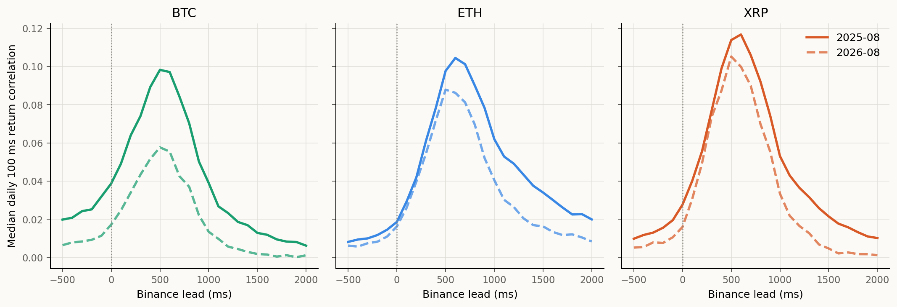
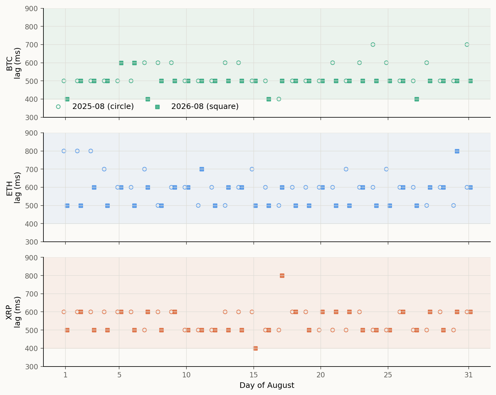

# Binance の先行は 1 年で変わったか — 2025 年 8 月と 2026 年 8 月を 100 ms で比べる

**要旨。** Binance の BTC・ETH・XRP 現物と、GMO の同銘柄レバレッジ市場を、
2025 年 8 月と 2026 年 8 月で比較しました。100 ms 単位の相関曲線のピークは、
BTC が 500 → 500 ms、ETH が 600 → 500 ms、XRP が 600 → 500 ms。
ピークは 1 年後も 500〜600 ms の帯にありました。一方、Binance の値動きと GMO の
次の 1 秒の値動きとの相関は、BTC で 0.426 → 0.310、ETH で
0.545 → 0.432、XRP で 0.508 → 0.423 と、3 銘柄すべてで低下しました。

今回の 31 日間から、どちらが何 ms 先に動くかは測れます。しかし、その関係が
1 年後も同じかは、片方の期間だけを見ても分かりません。そして 1 秒以上の
ローソク足では、そもそも 500 ms と 600 ms を区別できません。

## 最初の測定は「先行なし」だった

最初、私は BTC の中値を **1 秒グリッド**に載せ、そこから 5 秒、15 秒、
60 秒のバーを作りました。国内側のリターンと Binance のリターンをずらして
相関を取り、ピークが 1 秒なら Binance が 1 秒先、0 秒なら同じバーの中です。

下表は、2026 年 1〜8 月から月ごとに 1 日ずつ選んだ 8 日のうち、両市場の
データがそろう 7 日について、最初と同じ方法で再計算した日別結果の中央値です。

| バー長 | Coincheck BTC 現物 | bitbank BTC 現物 | GMO BTC レバレッジ |
|---|---|---|---|
| 1 秒 | 同じ秒（相関 0.431） | 1 秒後（相関 0.233） | 同じ秒（相関 0.450） |
| 5 秒 | 同じ足（相関 0.830） | 同じ足（相関 0.537） | 同じ足（相関 0.818） |
| 15 秒 | 同じ足（相関 0.926） | 同じ足（相関 0.765） | 同じ足（相関 0.931） |
| 60 秒 | 同じ足（相関 0.963） | 同じ足（相関 0.906） | 同じ足（相関 0.961） |

5 秒以上では、すべて同じ足です。この結果だけを見て、私は「先行は観測できない」
と結論しました。しかし、これは市場についての結論ではなく、物差しの限界でした。

## 板は、1 秒の内側でも動いている

2026 年 1〜8 月から別に選んだ 5 日について、板の記録間隔を調べると、
次のようになります。

| 取引所 | 1 日の記録数（中央値） | 記録間隔（日別平均の中央値） |
|---|---:|---:|
| Binance | 850,803 | **101.6 ms** |
| bitbank | 226,937 | 380.7 ms |
| Coincheck | 232,213 | 372.1 ms |
| GMO | 176,246 | 490.2 ms |

国内側も平均 0.37〜0.49 秒に 1 回更新されています。0.5 秒前後の順番を
測れる可能性があるデータを、1 秒へ丸めてから見ていたことになります。

そこでグリッドを **100 ms** に細かくし、Binance に対する GMO の遅れを
-1000〜+3000 ms の範囲で探索します。正の値は「Binance が先、GMO が後」
です。

## 同じ 8 月を、1 年離して比べる

比較するのは **2025 年 8 月 1〜31 日**と **2026 年 8 月 1〜31 日**です。
同じ暦月なら季節の違いを抑えられ、31 日ずつを丸ごと使えます。また
2025 年 8 月は、信頼できるデータが始まる 7 月の境界から 1 か月離れています。
結果が大きく見える月ではなく、この条件で期間を固定しました。

使う価格は、同じ数量を成行で売買すると仮定したときの、買いと売りの
平均約定単価の中間です。数量は BTC 0.002、ETH 0.1、XRP 150。
板の一番上だけでなく、その数量を満たすまで板を歩いて両市場の価格を作ります。
板が数量を満たせない行と、数量を考慮したスプレッドが 100 bps を超える行は
除外しました。1 bps は 0.01% です。

各日を独立に測り、その日の相関が最大になるラグを求めます。両期間とも
3 銘柄 × 31 日のすべてを利用できました。

## 相関曲線のピークは、ETH と XRP で 100 ms 早まった

| ペア | 2025 年 8 月 | 2026 年 8 月 | 変化 |
|---|---:|---:|---:|
| Binance BTC 現物 → GMO BTC レバレッジ | **500 ms** | **500 ms** | 0 ms |
| Binance ETH 現物 → GMO ETH レバレッジ | **600 ms** | **500 ms** | −100 ms |
| Binance XRP 現物 → GMO XRP レバレッジ | **600 ms** | **500 ms** | −100 ms |

この表は、各ラグについて 31 個の日次相関の中央値を取り、その曲線が最大になる
位置です。BTC は変わらず、ETH と XRP は 100 ms 早まりました。いずれの
銘柄・期間でも、31 日すべてで Binance が先でした。日ごとのピークもすべて
400〜800 ms に入り、0 ms や数秒へ移った日はありません。



実線が 2025 年、破線が 2026 年です。BTC の山は 500 ms のまま、ETH と XRP の
山は 600 ms から 500 ms へ移っています。



上の図は、各月 31 日の日別ピークを重ねたものです。横軸は 8 月の日付、縦軸は
その日の相関が最大になったラグです。**白抜きの丸（○）が 2025 年、塗りつぶした
四角（■）が 2026 年**を表します。同じ日・同じラグの点は重なります。
日別ピークの中央値は、BTC が 500 → 500 ms、ETH が 600 → 600 ms、XRP が
600 → 500 ms でした。ETH では「日別ピークを先に求めてから中央値を取る」と
600 ms のままですが、「各ラグの日次相関を先に中央値にして曲線を作る」と
500 ms がわずかに最大になります。集計の順序が違うためで、どちらの図でも分布の
中心が 500〜600 ms にあるという読み方は変わりません。

## 変わったのは、先行の強さだった

100 ms の相関値は、呼値や板の更新頻度の影響を受けます。そこで期間どうしの
強さは、より粗い **「Binance のこの 1 秒」と「GMO の次の 1 秒」の相関**で
比較します。これは 500 ms と 600 ms を見分ける指標ではありませんが、関係が
どれだけ次の秒へ残るかを見るには使えます。

| ペア | 2025 年 8 月 | 2026 年 8 月 | 変化率 |
|---|---:|---:|---:|
| BTC | 0.426 | 0.310 | **−27.2%** |
| ETH | 0.545 | 0.432 | **−20.7%** |
| XRP | 0.508 | 0.423 | **−16.7%** |

3 銘柄とも、2026 年のほうが低くなりました。したがって今回の結果は、
「500〜600 ms という帯は 1 年後も同じで、曲線のピークは最大 100 ms 早まったが、
先行関係の強さまで一定ではない」です。

ただし、この比較だけでは低下の理由は分かりません。呼値、更新頻度、ボラティリティ、
市場参加者の変化は分離していません。2 つの月から長期トレンドを推定することも
できません。測れたのは、同じ暦月を 1 年離して比べたときの差です。

## 1 か月のスナップショットだけでは分からないこと

この実験には、異なる 2 種類の細かさが必要でした。

- **時間方向の細かさ。** 500 ms と 600 ms を分けるには、1 秒足より細かい
  記録が要ります。1 分足はもちろん、1 秒足でもピークの位置は決まりません。
- **期間方向の広さ。** 2026 年 8 月だけなら、Binance が約 0.5〜0.6 秒先という
  結論で終わります。2025 年の同月と比べて初めて、位置は安定していても強さは
  弱くなったと分かります。

ローソク足で分かるのは、数秒・数分の中で 2 市場が一緒に動いたことまでです。
どちらが先に価格を作ったかは足の内側に消えます。そして高頻度データが 1 か月分
だけあっても、その関係が時間をまたいで安定しているかは判定できません。

## この記事が言っていないこと

- **0.5〜0.6 秒で利益が出るとは言っていません。** 検知と執行は別です。
  通信・注文・約定の遅延、手数料、スプレッドを越えなければ、順番が分かっても
  取引機会にはなりません。
- **相関の低下が今後も続くとは言っていません。** 比べたのは 2 つの月です。
  毎月の系列を作らなければ、傾向か一時的な差かは分かりません。
- **因果は示していません。** 時系列の順番と相関を測っただけです。為替や第三市場が
  両方を動かしている可能性は分離していません。
- **GMO 以外へ一般化していません。** 最初の少数日測定では Coincheck の符号が
  安定しませんでした。主測定は GMO の 3 銘柄に限定しています。

## 測定条件

- 期間: 2025-08-01〜08-31 と 2026-08-01〜08-31（日本時間の日付）
- 市場: Binance の BTC・ETH・XRP 現物と、GMO の同銘柄レバレッジ市場
- 価格: 同じ数量を板で約定させた買い・売り平均価格の中間
- グリッド: 100 ms。日単位のピアソン相関、探索 -1000〜+3000 ms
- 強さの比較: Binance の同じ 1 秒と GMO の次の 1 秒のリターン相関
- 有効日: 各ペア・各期間とも 31 日。欠けた日の補充や期間の延長はしていない
- 最初の粗い測定: 2026 年 1〜8 月から月ごとに選んだ 8 日のうち有効な 7 日
- 板の記録間隔: 同じ期間から別に選んだ 5 日

> **GMO の市場について。** 本記事の `GMO:*_JPY` はレバレッジ市場です。
> 同じ銘柄の現物市場 `GMO:*_SPOT` とは手数料体系もスプレッドも異なります。

## 自分で確かめるには

まず ETH の 2 市場について、同じ 8 月を 31 日ずつ用意します。

```bash
pip install kamakuraquantlab-komachi

komachi download --market GMO:ETH_JPY --start 2025-08-01 --days 31
komachi download --market BINANCE:ETH_USDT --start 2025-08-01 --days 31
komachi download --market GMO:ETH_JPY --start 2026-08-01 --days 31
komachi download --market BINANCE:ETH_USDT --start 2026-08-01 --days 31
python3 leadlag_100ms.py \
  --asset ETH --start 2025-08-01 --compare-start 2026-08-01 --days 31
```

`leadlag_100ms.py` は、板の最良気配の中値を 100 ms ごとに並べ、日ごとのピークを
比較する最小構成です。本文の主測定は数量を指定して板を歩く価格を使うため、
相関値は完全には一致しません。確認するのは、ピークが 0 ではなく 500〜600 ms
付近に現れることと、2 期間を同じ条件で比べられることです。

Komachi が置く `date=` は両市場とも日本時間の日付です。UTC 日付のデータを国内市場へ
そのまま結合すると 9 時間ずれるため、日付境界を混ぜないでください。

**ピークの位置を測るなら、グリッドを 1 秒にしないこと。変化を測るなら、
1 つの月だけで終わらせないこと。**

**この記事のスクリプトは 4 本です。**

| 節 | スクリプト | 読むもの | 出力 |
|---|---|---|---|
| 「最初の測定は『先行なし』だった」 | `analysis.py` | 板 | `output/leadlag.json` |
| 「板は、1 秒の内側でも動いている」 | `cadence.py` | 板 | `output/cadence.json` |
| 「同じ 8 月を、1 年離して比べる」〜「変わったのは、先行の強さだった」 | `report_analysis.py` | 日次の測定 CSV | `output/report_summary.json`, `output/leadlag_curve.png`, `output/leadlag_daily.png` |
| 「自分で確かめるには」 | `leadlag_100ms.py` | 板 | `output/leadlag_100ms.json` |

`analysis.py` は 1 秒グリッドの最初の計測です。誤った結論へ至った測定も残すことで、
分解能を変える前後を同じデータから確認できます。

---

*測定コードと出力: [GitHub の記事ディレクトリ](https://github.com/kamakuraquantlab/Kenchoji/tree/main/assets/04_binance-lead-lag)*
